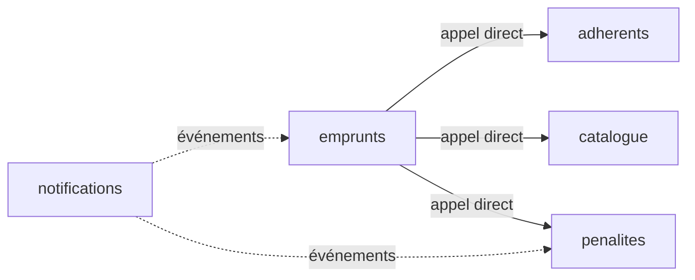

# SunuBiblio — prêts de la bibliothèque universitaire

Monolithe modulaire Spring Boot + Spring Modulith (TP Module 5.2, projet 2).
Base de données : PostgreSQL `SunuBiblio` (tests : H2 en mémoire).

Auteur : Mansour Niang — binôme : _à compléter_

## 1. Conception

### 1.1 Les modules

| Module | Responsabilité | Il possède | Il expose (porte d'entrée) | Il annonce | Dépend de |
|---|---|---|---|---|---|
| `catalogue` | Connaître les livres et savoir si chaque exemplaire est disponible, emprunté ou retiré. | Livre, Exemplaire (états `DISPONIBLE`, `EMPRUNTE`, `RETIRE`) | `CatalogueApi`, `LivreDto`, `ExemplaireDto` | — | — |
| `adherents` | Inscrire les adhérents et dire combien d'exemplaires chacun peut emprunter. | Adhérent (type étudiant ou enseignant, quota) | `AdherentsApi`, `AdherentDto`, `TypeAdherent` | — | — |
| `penalites` | Calculer, enregistrer et encaisser les pénalités de retard. | Pénalité (jours de retard, montant, statut) | `PenalitesApi`, `PenaliteDto` | `PenaliteCreee`, `PenalitePayee` | — |
| `emprunts` | Prêter et reprendre les exemplaires en appliquant les règles de prêt (quota, 14 jours, blocage). | Emprunt (dates de prêt, d'échéance et de retour) | `EmpruntsApi`, `EmpruntDto`, `RetourDto`, `SituationAdherentDto` | `EmpruntEnregistre`, `ExemplaireRendu` | `adherents`, `catalogue`, `penalites` |
| `notifications` | Prévenir l'adhérent (SMS simulé dans les logs). | Journal des messages (en mémoire) | `NotificationsApi`, `NotificationDto` | — | `emprunts`, `penalites` |

Chaque module est un package sous `com.sunubiblio`. La porte d'entrée (interface, DTO, événements, exceptions publiques) est à la racine du module ; tout le reste est dans `internal` (`domain`, `application`, `infrastructure`).

`notifications` n'est pas dans la liste F1 à F9 du sujet : c'est un ajout volontaire (prévenir l'adhérent), qui sert aussi de module écouteur d'événements.

### 1.2 Chaque fonctionnalité dans un seul module

| N° | Fonctionnalité | Module |
|---|---|---|
| F1 | Ajouter un livre et ses exemplaires | `catalogue` |
| F2 | Retirer un exemplaire abîmé | `catalogue` |
| F3 | S'inscrire comme adhérent (étudiant ou enseignant) | `adherents` |
| F4 | Rechercher un livre et voir les exemplaires disponibles | `catalogue` |
| F5 | Emprunter un exemplaire | `emprunts` |
| F6 | Rendre un exemplaire | `emprunts` |
| F7 | Créer une pénalité quand un exemplaire est rendu en retard | `penalites` |
| F8 | Payer sa pénalité | `penalites` |
| F9 | Consulter ses emprunts en cours et ses pénalités | `emprunts` (il lit déjà `penalites`) |

### 1.3 Règles du métier : où elles vivent

| Règle | Module | Où dans le code |
|---|---|---|
| Un étudiant emprunte au plus 3 exemplaires, un enseignant 5 | `adherents` (le quota) et `emprunts` (le comptage) | `TypeAdherent`, `RegleEmprunt` |
| Un prêt dure 14 jours | `emprunts` | `Emprunt` |
| La pénalité est de 100 XOF par jour de retard | `penalites` | `Penalite` |
| Un adhérent avec une pénalité impayée ne peut pas emprunter | `emprunts` (décision) grâce à `penalites` (information) | `RegleEmprunt` |

### 1.4 Schéma des dépendances (sans cycle)

Trait plein : appel direct par l'API publique. Trait pointillé : écoute d'un événement (elle crée aussi une dépendance, vers le module qui définit l'événement).

| Flèche | Type | Pourquoi |
|---|---|---|
| `emprunts` → `adherents` | appel direct | Il faut connaître le type et le quota de l'adhérent tout de suite pour accepter ou refuser l'emprunt. |
| `emprunts` → `catalogue` | appel direct | Il faut vérifier et marquer l'exemplaire « emprunté » dans la même transaction que l'emprunt ; au retour, il est rendu disponible de la même façon. |
| `emprunts` → `penalites` | appel direct | Réponse immédiate nécessaire (« y a-t-il une pénalité impayée ? »), et la pénalité est créée dans la même transaction que le retour en retard. |
| `notifications` → `emprunts` | événements `EmpruntEnregistre`, `ExemplaireRendu` | Prévenir l'adhérent est un effet de bord : il ne doit ni bloquer ni annuler un emprunt, et `emprunts` n'a pas à connaître `notifications`. |
| `notifications` → `penalites` | événements `PenaliteCreee`, `PenalitePayee` | Même raison. |

### 1.5 Pourquoi il n'y a pas de cycle

Le piège du sujet est la paire `emprunts` / `penalites` : un emprunt doit demander s'il y a une pénalité impayée (`emprunts` → `penalites`), et une pénalité naît d'un retour (on pourrait vouloir `penalites` → `emprunts` en écoutant `ExemplaireRendu`). Ensemble, cela ferait un cycle. J'ai choisi un seul sens : `emprunts` → `penalites`. C'est donc `emprunts` qui appelle `penalites` au retour en retard, et `penalites` ne connaît personne. `notifications` est une feuille : elle écoute, mais personne ne dépend d'elle.

### 1.6 Les deux modes de communication

- Appels directs : `emprunts` appelle `AdherentsApi`, `CatalogueApi` et `PenalitesApi`.
- Événements : `emprunts` publie `EmpruntEnregistre` et `ExemplaireRendu`, `penalites` publie `PenaliteCreee` et `PenalitePayee` ; `notifications` les écoute.
- Références par identifiant : seuls des `UUID` (identifiants d'adhérent, d'exemplaire, d'emprunt, de pénalité) et des DTO traversent les frontières, jamais un objet du domaine.
