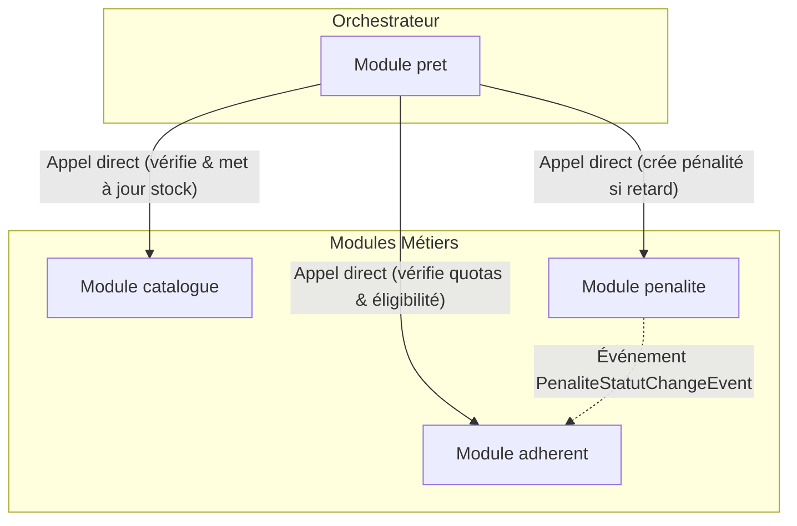

# SunuBiblio — Prêts de la Bibliothèque Universitaire
> Monolithe Modulaire avec Spring Boot & Spring Modulith

---

## 1. Présentation du Projet

**SunuBiblio** est un système de gestion des prêts d'une bibliothèque universitaire (étudiants et enseignants). Il permet de suivre les livres et leurs exemplaires physiques, les emprunts, les retards, ainsi que la facturation et le recouvrement des pénalités.

### Règles Métier
* **Quotas d'emprunt** : Un étudiant peut emprunter au plus **3 exemplaires** à la fois ; un enseignant au plus **5 exemplaires**.
* **Durée de prêt** : **14 jours**.
* **Pénalité de retard** : **100 XOF par jour de retard**.
* **Règle de blocage** : Un adhérent ayant une pénalité impayée **ne peut plus emprunter**.

### Scénario de bout en bout
1. Ajouter un livre avec 1 exemplaire.
2. Inscrire un étudiant.
3. Emprunter l'exemplaire.
4. Vérifier que l'exemplaire n'est plus disponible.
5. Rendre l'exemplaire avec 3 jours de retard.
6. Constater qu'une pénalité de 300 XOF existe et que l'exemplaire est de nouveau disponible.
7. Tenter un nouvel emprunt ➔ **refusé** car l'adhérent a une pénalité impayée.
8. Payer la pénalité.
9. Tenter à nouveau l'emprunt ➔ **accepté**.

---

## 2. Découpage en Modules & Répartition des Fonctionnalités

Le système est découpé en **4 modules métiers** étanches :

| Module | Responsabilité | Fonctionnalités couvertes |
| :--- | :--- | :--- |
| **`catalogue`** | Gestion du catalogue de livres, du stock d'exemplaires physiques et de leur disponibilité. | **F1** (Ajout livre/exemplaires), **F2** (Retrait exemplaire abîmé), **F4** (Recherche livre & dispo) |
| **`adherent`** | Gestion des comptes adhérents (étudiant/enseignant), de leurs quotas et de leur statut d'éligibilité (bloqué/actif). | **F3** (Inscription adhérent) |
| **`pret`** | Orchestration du cycle de vie des emprunts et retours, vérification des conditions de prêt et calcul des retards. | **F5** (Emprunter), **F6** (Rendre), **F9** (Consultation emprunts) |
| **`penalite`** | Source de vérité sur la création des pénalités financières et leur encaissement/paiement. | **F7** (Création pénalité), **F8** (Paiement pénalité), **F9** (Consultation pénalités) |

---

## 3. Spécification des Modules (Tableau de Conception)

| Module | Responsabilité | Il possède (Interne) | Il expose (API Publique) | Il annonce (Événements) | Dépend de |
| :--- | :--- | :--- | :--- | :--- | :--- |
| **`catalogue`** | Gestion des livres et du stock d'exemplaires physiques | `Livre`, `Exemplaire`, `StatutExemplaire` (DISPONIBLE, EMPRUNTE, RETIRE) | `CatalogueApi` (ajouterLivre, verifierDisponibilite, marquerEmprunte, marquerDisponible, rechercherLivres) | *(aucun)* | *(aucun)* |
| **`penalite`** | Gestion comptable des pénalités et encaissements | `Penalite`, `StatutPenalite` (IMPAYEE, REGLEE) | `PenaliteApi` (creerPenalite, reglerPenalite, getPenalitesAdherent) | `PenaliteStatutChangeEvent` (adherentId, aDesImpayes, montantTotalImpaye) | *(aucun)* |
| **`adherent`** | Gestion des profils adhérents et de leur éligibilité | `Adherent`, `TypeAdherent` (ETUDIANT, ENSEIGNANT) | `AdherentApi` (inscrire, trouver, verifierEligibiliteEmprunt) | *(aucun)* | **`penalite`** *(écoute l'événement `PenaliteStatutChangeEvent`)* |
| **`pret`** | Orchestration des prêts et calcul des retards | `Emprunt`, `StatutEmprunt` (EN_COURS, RESTITUE) | `PretApi` (emprunter, restituer, getEmpruntsEnCours, trouver) | *(aucun)* | **`catalogue`**, **`adherent`**, **`penalite`** *(appels directs synchrones)* |

---

## 4. Schéma des Dépendances & Justification des Flux

### Schéma Architectural (Graphe Acyclique)



### Justification des modes de communication et absence de cycle :
1. **Appels directs de `pret` vers `catalogue`, `adherent` et `penalite` :**
   * Pour valider un emprunt, `pret` doit garantir de façon atomique et synchrone que :
     * L'adhérent existe, respecte son quota et n'est pas bloqué (`adherent`).
     * L'exemplaire existe et est physiquement disponible (`catalogue`).
   * Lors d'une restitution en retard, `pret` demande directement à `penalite` de créer la dette financière correspondante.
2. **Événement `PenaliteStatutChangeEvent` de `penalite` vers `adherent` :**
   * `penalite` est la source de vérité financière. Dès qu'une pénalité est créée (impayée) ou réglée (solde à zéro), `penalite` publie cet événement.
   * `adherent` écoute cet événement et met à jour son drapeau interne `estBloquePourImpayes`.
   * **Conséquence :** `adherent` dépend de `penalite`. `penalite` ne connaît absolument pas `adherent` ni `pret`.
3. **Absence totale de cycle :**
   * `catalogue` : 0 dépendance.
   * `penalite` : 0 dépendance.
   * `adherent` : dépend uniquement de `penalite`.
   * `pret` : dépend de `catalogue`, `adherent`, `penalite`.
   * Aucune flèche de retour ➔ **DAG (Directed Acyclic Graph) parfait**.

Tout passe par le prêt : aucun autre module n'appelle `pret`, et c'est lui qui relie les trois autres pour un emprunt ou une restitution. L'événement est le seul lien qui ne part pas du prêt, et il va dans le sens `penalite` ➔ `adherent`.

---

## 5. Structure du code, lancement et commandes

### 5.1 Structure du code

```text
lydevtech.sunubiblio
├── SunuBiblioApplication, DotenvEnvironmentPostProcessor,
│   OpenApiConfiguration, GestionnaireErreursApi              (racine, hors module)
└── catalogue | adherent | penalite | pret
    ├── <Module>Api, DTO, événements, exceptions publiques    (porte d'entrée, racine du module)
    ├── package-info.java                                     (allowedDependencies)
    └── internal
        ├── domain          règles du métier (sans Spring) et ports (interfaces de dépôt)
        ├── application     services (cas d'usage) et écouteurs d'événements
        ├── infrastructure  dépôts JDBC, configuration
        └── web             contrôleur REST et gestionnaire d'erreurs du module
```

Chaque module possède ses tables (`catalogue_*`, `adherent_*`, `penalite_*`, `pret_*`) dans son propre script `src/main/resources/db/schema-<module>.sql`. Il n'y a aucune clé étrangère ni jointure entre modules : les modules se référencent par identifiant.

### 5.2 Lancer le projet

Prérequis : JDK 17 ou plus, PostgreSQL avec une base nommée `SunuBiblio`.

```bash
cp .env.example .env        # puis renseigner DB_URL, DB_USERNAME et DB_PASSWORD
./mvnw spring-boot:run
```

Sous Windows PowerShell, depuis le dossier du projet :

```powershell
Copy-Item .env.example .env   # puis renseigner DB_URL, DB_USERNAME et DB_PASSWORD
.\mvnw.cmd spring-boot:run
```

Les autres commandes `./mvnw ...` de ce document s'écrivent `.\mvnw.cmd ...` sous PowerShell. Le fichier `.env` n'est jamais commité. Les tables sont créées au démarrage.

### 5.3 Tests

```bash
# Lancer tous les tests (frontières Spring Modulith + règles + API + scénario de bout en bout)
./mvnw test

# Lancer uniquement le test d'architecture Spring Modulith
./mvnw test -Dtest=ModulesTest
```

Résultat observé : `Tests run: 88, Failures: 0, Errors: 0, Skipped: 0`.

| Test | Rôle |
|---|---|
| `ModulesTest` (2) | Le gardien : `verify()` doit passer, et les 4 modules attendus sont bien détectés (le test ne passe donc pas à vide). |
| `ScenarioBoutEnBoutTest` (1) | Le scénario du sujet, étape par étape par l'API REST, avec chaque résultat annoncé vérifié (exemplaire indisponible, retard de 3 jours, pénalité de 300 XOF, nouvel emprunt refusé, paiement, emprunt accepté). |
| Tests de domaine (28) | Les règles du métier sans Spring ni base : états d'un exemplaire, quotas, 14 jours, 100 XOF par jour, blocage. |
| Tests d'intégration (24) | Chaque module par l'API REST : catalogue et recherche, adhérents, règles d'emprunt, blocage par événements (dont deux pénalités à régler), événements publiés. |
| `ErreursApiIntegrationTest` (22) et `ErreursServeurIntegrationTest` (4) | Chaque cas d'erreur de l'API : bon code, format Problem Details et message exact ; les pannes du serveur (500, 503, conflit de base) ne montrent aucun détail interne. |
| `ContratOpenApiTest` (5) | Tous les endpoints sont décrits, les erreurs suivent Problem Details, les codes de succès sont les vrais, Swagger UI est servi, et `docs/openapi.yaml` est identique au contrat de l'application. |
| `BaseDeTestTest`, `SunuBiblioApplicationTests` | Garde : les tests tournent sur H2 en mémoire, jamais sur la base PostgreSQL `SunuBiblio` ; le contexte Spring démarre. |

### 5.4 L'API REST

Swagger UI : <http://localhost:8080/swagger-ui.html> (pour essayer toutes les requêtes dans le navigateur).
Contrat OpenAPI : [`docs/openapi.yaml`](docs/openapi.yaml), identique à celui publié par l'application sur `/v3/api-docs` (un test le vérifie).
Pour le regénérer après un changement de l'API : `./mvnw test -Dtest=ContratOpenApiTest -Dopenapi.regenerer=true`.

| Fonctionnalité | Requête |
|---|---|
| F1 Ajouter un livre et ses exemplaires | `POST /api/catalogue/livres` `{"isbn", "titre", "auteur", "nombreExemplaires"}` (avec un ISBN déjà connu, les exemplaires s'ajoutent au livre) |
| F2 Retirer un exemplaire abîmé | `DELETE /api/catalogue/exemplaires/{id}` |
| F3 S'inscrire | `POST /api/adherents` `{"nom", "type": "ETUDIANT" ou "ENSEIGNANT"}` ; `GET /api/adherents/{id}` |
| F4 Rechercher un livre | `GET /api/catalogue/livres?q=texte` (titre, auteur ou ISBN, sans tenir compte des majuscules) ; `GET /api/catalogue/livres/{isbn}` |
| F5 Emprunter | `POST /api/prets` `{"adherentId", "exemplaireId"}` |
| F6 Rendre | `POST /api/prets/{id}/restitution` (corps optionnel `{"dateRetour": "AAAA-MM-JJ"}`, par défaut aujourd'hui) |
| F7 Pénalité de retard | automatique à la restitution en retard (`penalite` dans la réponse) |
| F8 Payer une pénalité | `POST /api/penalites/{id}/payer` |
| F9 Emprunts en cours et pénalités | `GET /api/prets?adherentId=...` ; `GET /api/penalites?adherentId=...` |

### 5.5 Les erreurs

Toutes les erreurs suivent le même format Problem Details (`application/problem+json`, RFC 9457) : `status`, `title` et `detail`, un message en français qui dit ce qui ne va pas et comment corriger, jamais de détail interne.

| Code | Cas | Exemple de message |
|---|---|---|
| 400 | Corps absent ou JSON mal formé | « Le corps de la requête n'est pas un JSON valide : vérifiez les guillemets, les virgules et les accolades. » |
| 400 | Valeur d'énumération inconnue | « Le champ 'type' n'accepte pas la valeur 'VISITEUR' : valeurs possibles : ETUDIANT, ENSEIGNANT. » |
| 400 | Champ du mauvais type ou date mal formée | « Le champ 'dateRetour' n'est pas valide : une date valide au format AAAA-MM-JJ est attendue (valeur reçue : '16/03/2026'). » |
| 400 | Champs manquants ou hors limites | `detail` résume, et `erreurs` liste chaque champ : `[{"champ": "titre", "message": "Le titre du livre est obligatoire."}, ...]` |
| 400 | Paramètre obligatoire absent | « Le paramètre 'adherentId' est obligatoire dans l'adresse de la requête. » |
| 400 | Date de retour avant la date d'emprunt | « La date de retour (2000-01-01) ne peut pas précéder la date d'emprunt (2026-03-02) : indiquez une date postérieure ou égale. » |
| 404 | Livre, exemplaire, adhérent, emprunt ou pénalité inconnu, ou route inconnue | « Aucun adhérent ne correspond à l'identifiant ... : vérifiez-le ou inscrivez l'adhérent avant de continuer. » |
| 405 / 415 / 406 | Méthode, type de contenu ou format non pris en charge | « La méthode PUT n'est pas autorisée sur cette adresse : utilisez GET ou POST. » |
| 409 | Règle du métier refusée (quota, pénalité impayée, exemplaire indisponible, déjà rendu ou payé) | « L'adhérent ... a déjà 3 exemplaires empruntés, ce qui est son maximum : il doit en rendre un avant d'en emprunter un autre. » |
| 409 | Conflit avec des données existantes | « L'opération est en conflit avec des données existantes (doublon ou référence inexistante) : vérifiez les identifiants envoyés. » |
| 500 | Erreur inattendue | « Une erreur inattendue s'est produite [...] communiquez l'identifiant de suivi 3f9a1c2e à l'équipe technique. » (la cause n'est que dans les logs, avec le même `traceId`) |
| 503 | Base de données indisponible | « La base de données est momentanément indisponible : réessayez dans quelques instants. » (avec l'en-tête `Retry-After`) |

### 5.6 Rejouer le scénario à la main

```bash
curl -X POST localhost:8080/api/catalogue/livres -H "Content-Type: application/json" \
  -d '{"isbn":"978-2-7087-0000-0","titre":"Une si longue lettre","auteur":"Mariama Ba","nombreExemplaires":1}'
curl -X POST localhost:8080/api/adherents -H "Content-Type: application/json" \
  -d '{"nom":"Awa Diop","type":"ETUDIANT"}'
curl -X POST localhost:8080/api/prets -H "Content-Type: application/json" \
  -d '{"adherentId":"<id adhérent>","exemplaireId":"<id exemplaire>"}'
curl localhost:8080/api/catalogue/livres/978-2-7087-0000-0     # l'exemplaire est EMPRUNTE
curl -X POST localhost:8080/api/prets/<id emprunt>/restitution -H "Content-Type: application/json" \
  -d '{"dateRetour":"<dateEcheance + 3 jours>"}'               # pénalité de 300 XOF
curl -X POST localhost:8080/api/prets -H "Content-Type: application/json" \
  -d '{"adherentId":"<id adhérent>","exemplaireId":"<id exemplaire>"}'   # 409 : refusé
curl -X POST localhost:8080/api/penalites/<id pénalité>/payer
curl -X POST localhost:8080/api/prets -H "Content-Type: application/json" \
  -d '{"adherentId":"<id adhérent>","exemplaireId":"<id exemplaire>"}'   # 201 : accepté
```

### 5.7 L'interface web (Next.js)

Le dossier [`frontend/`](frontend) contient l'interface : catalogue avec recherche, ouverture de compte, « Mon compte » (emprunts, pénalités, paiement) et poste de la bibliothécaire.

```bash
cd frontend
npm install
npm run dev        # http://localhost:3000, l'API doit tourner sur http://localhost:8080
```

L'adresse de l'API se règle avec la variable `API_URL` (par défaut `http://localhost:8080`) : le navigateur appelle `/api/...` sur le port 3000 et Next.js relaie vers l'API.

---

## 6. Étape 3 : Démonstration de Violation de Frontière (Modulith)

Les deux violations ont été provoquées volontairement, les messages ci-dessous sont les messages réels de `./mvnw test -Dtest=ModulesTest` (l'application compile dans les deux cas : c'est le test qui garde les frontières). Dans les deux cas la classe fautive a ensuite été supprimée et la suite complète est repassée au vert (88 tests).

### 6.1 Accès à une classe `internal` d'un autre module

J'ai ajouté dans `pret` une classe qui utilise `lydevtech.sunubiblio.catalogue.internal.domain.Exemplaire`. Le test échoue :

```text
org.springframework.modulith.core.Violations:
- Module 'pret' depends on non-exposed type lydevtech.sunubiblio.catalogue.internal.domain.Exemplaire within module 'catalogue'!
Exemplaire declares return type Exemplaire.exemplaireInterneDuCatalogue() in (ViolationVolontaire.java:0)
- Module 'pret' depends on non-exposed type lydevtech.sunubiblio.catalogue.internal.domain.Exemplaire within module 'catalogue'!
Method <lydevtech.sunubiblio.pret.internal.application.ViolationVolontaire.exemplaireInterneDuCatalogue()> calls constructor <lydevtech.sunubiblio.catalogue.internal.domain.Exemplaire.<init>(java.lang.String, java.lang.String)> in (ViolationVolontaire.java:9)
- Module 'pret' depends on non-exposed type lydevtech.sunubiblio.catalogue.internal.domain.Exemplaire within module 'catalogue'!
Method <lydevtech.sunubiblio.pret.internal.application.ViolationVolontaire.exemplaireInterneDuCatalogue()> has return type <lydevtech.sunubiblio.catalogue.internal.domain.Exemplaire> in (ViolationVolontaire.java:0)
```

**Lecture du message :** `pret` a le droit de dépendre de `catalogue` (c'est déclaré), mais seulement de ce que `catalogue` expose à la racine de son package. `Exemplaire` est dans `internal.domain` : Modulith le déclare « non exposé ».

**Correction :** `pret` passe par la porte d'entrée du module, `CatalogueApi` (par exemple `marquerEmprunte(exemplaireId)`), et ne manipule que des identifiants et des DTO. Le domaine d'un module reste privé.

### 6.2 Cycle entre modules

J'ai fait dépendre `penalite` de `pret` (une classe de `penalite` lisait un `EmpruntDto`), alors que `pret` dépend déjà de `penalite`. Le test échoue (message raccourci : `[...]` marque les lignes omitées, les deux cycles détectés sont conservés) :

```text
org.springframework.modulith.core.Violations:
- Cycle detected: Slice adherent ->
                Slice penalite ->
                Slice pret ->
                Slice adherent
  1. Dependencies of Slice adherent
    - Method <lydevtech.sunubiblio.adherent.internal.application.EcouteurPenalites.surChangementDeStatut(lydevtech.sunubiblio.penalite.PenaliteStatutChangeEvent)> has parameter of type <lydevtech.sunubiblio.penalite.PenaliteStatutChangeEvent> in (EcouteurPenalites.java:0)
    [...]
  2. Dependencies of Slice penalite
    - Method <lydevtech.sunubiblio.penalite.internal.application.ViolationCycle.origine(lydevtech.sunubiblio.pret.EmpruntDto)> has parameter of type <lydevtech.sunubiblio.pret.EmpruntDto> in (ViolationCycle.java:0)
    - Method <lydevtech.sunubiblio.penalite.internal.application.ViolationCycle.origine(lydevtech.sunubiblio.pret.EmpruntDto)> calls method <lydevtech.sunubiblio.pret.EmpruntDto.id()> in (ViolationCycle.java:9)
  3. Dependencies of Slice pret
    - Field <lydevtech.sunubiblio.pret.internal.application.PretService.adherentApi> has type <lydevtech.sunubiblio.adherent.AdherentApi> in (PretService.java:0)
    [...]
- Cycle detected: Slice penalite ->
                Slice pret ->
                Slice penalite
  1. Dependencies of Slice penalite
    - Method <lydevtech.sunubiblio.penalite.internal.application.ViolationCycle.origine(lydevtech.sunubiblio.pret.EmpruntDto)> has parameter of type <lydevtech.sunubiblio.pret.EmpruntDto> in (ViolationCycle.java:0)
    [...]
  2. Dependencies of Slice pret
    - Method <lydevtech.sunubiblio.pret.internal.application.PretService.restituer(java.lang.String, java.time.LocalDate)> calls method <lydevtech.sunubiblio.penalite.PenaliteApi.creerPenalite(java.lang.String, java.lang.String, long)> in (PretService.java:66)
    [...]
- Module 'penalite' depends on module 'pret' via lydevtech.sunubiblio.penalite.internal.application.ViolationCycle -> lydevtech.sunubiblio.pret.EmpruntDto. Allowed targets: none.
```

**Lecture du message :** le premier cycle passe aussi par `adherent` (`adherent` écoute `penalite`, `pret` appelle `adherent`) ; le plus court est `penalite ➔ pret ➔ penalite`. La dernière ligne rappelle la règle : `penalite` déclare `allowedDependencies = {}`, aucune cible n'est autorisée.

**Correction :** `penalite` reçoit ce dont elle a besoin en paramètres (`creerPenalite(adherentId, exemplaireId, joursDeRetard)`) et ne demande rien à `pret` ; si elle doit prévenir quelqu'un, elle annonce un événement que l'autre module écoute.

---

## 7. Décisions d'architecture

| Décision | Contexte | Conséquences |
|---|---|---|
| Le prêt est l'unique point de passage : seul `pret` appelle les autres modules | Un sens unique évite tout cycle, et le prêt est le cœur du métier. | Aucun module ne dépend de `pret`, qui n'annonce donc aucun événement. Ajouter un module qui réagit à un emprunt demanderait de revoir ce choix. |
| Le blocage d'un adhérent vient de l'événement `PenaliteStatutChangeEvent` | Le prêt doit refuser un emprunt si une pénalité est impayée, sans que `penalite` ne dépende d'`adherent` ou de `pret`. | L'événement porte l'état complet (`aDesImpayes`, `montantTotalImpaye`) : avec plusieurs pénalités, l'adhérent n'est libéré que lorsque la dernière est payée. L'écoute est synchrone et dans la transaction de l'émetteur : le blocage est enregistré, ou annulé, avec la pénalité. |
| Pas de module de notifications | Les notifications ne font pas partie des fonctionnalités F1 à F9 ; les événements servent le métier. | Le module a été retiré ; l'événement a un vrai rôle (le blocage). |
| PostgreSQL à l'exécution, H2 en mémoire pour les tests | Base demandée : `SunuBiblio`. Les tests ne doivent jamais modifier les vraies données. | Le profil `test` impose H2 ; `BaseDeTestTest` le vérifie. Le `.env` a la priorité la plus basse et ne peut pas écraser une propriété de test. |
| Dépôts JDBC dans `infrastructure`, derrière les interfaces du domaine | Le domaine ne doit pas connaître la base. | Les services dépendent d'interfaces ; on peut changer de stockage sans toucher aux règles. |
| Chaque règle à un seul endroit | Les valeurs (3 et 5 exemplaires, 14 jours, 100 XOF) ne doivent pas être recopiées. | `TypeAdherent` (quotas), `Emprunt.DUREE_PRET_JOURS`, `Penalite.TARIF_PAR_JOUR_XOF`. |
| Lecture avec verrou (`SELECT ... FOR UPDATE`) avant de modifier un exemplaire, un adhérent ou une pénalité ; restitution par mise à jour conditionnelle | Deux requêtes simultanées sur le même objet. | Une seule gagne ; l'autre reçoit un 409 explicite plutôt qu'un état incohérent. |
| Contrat OpenAPI généré par springdoc, copié dans `docs/openapi.yaml` et verrouillé par un test | Le contrat doit rester cohérent avec le comportement réel. | Si l'API change sans mise à jour du fichier, `ContratOpenApiTest` échoue. Les erreurs sont décrites une seule fois (`ProblemDetail`). |

### Hypothèses retenues (règles ambiguës)

1. Un retour le jour de l'échéance, ou avant, n'est pas en retard ; le retard se compte en jours calendaires après l'échéance.
2. Un adhérent avec une pénalité impayée ne peut plus emprunter, mais peut toujours rendre ses exemplaires. Avec plusieurs pénalités impayées, il faut les payer toutes. Le blocage est signalé avant le quota.
3. Le quota compte les emprunts en cours (non rendus).
4. Un exemplaire en cours d'emprunt ne peut pas être retiré (il doit d'abord être rendu) ; un exemplaire retiré ne peut plus être emprunté.
5. Une pénalité est créée par emprunt rendu en retard et se paie en une seule fois.
6. La restitution accepte une date (par défaut aujourd'hui, jamais avant la date d'emprunt) pour rejouer un retard sans attendre 14 jours.
7. Ajouter un livre avec un ISBN déjà au catalogue ajoute des exemplaires à ce livre (titre et auteur inchangés).
8. La recherche porte sur le titre, l'auteur et l'ISBN ; `%` et `_` sont cherchés comme du texte.
9. Pas d'authentification (hors périmètre du TP).

### Glossaire

| Terme | Sens | À éviter |
|---|---|---|
| Livre | Une œuvre du catalogue (ISBN, titre, auteur). | document, ouvrage |
| Exemplaire | Un exemplaire physique d'un livre, `DISPONIBLE`, `EMPRUNTE` ou `RETIRE`. | copie, volume |
| Adhérent | Étudiant ou enseignant inscrit à la bibliothèque. | usager, lecteur, client |
| Emprunt | Le prêt d'un exemplaire à un adhérent, pour 14 jours (`EN_COURS` ou `RESTITUE`). | location |
| Restitution | Le moment où l'adhérent rend l'exemplaire. | retour (dans le code) |
| Pénalité | Somme due pour un retard (100 XOF par jour), `IMPAYEE` ou `REGLEE`. | amende, frais de retard |
| Blocage | État d'un adhérent qui a au moins une pénalité impayée : il ne peut plus emprunter. | suspension, interdiction |
