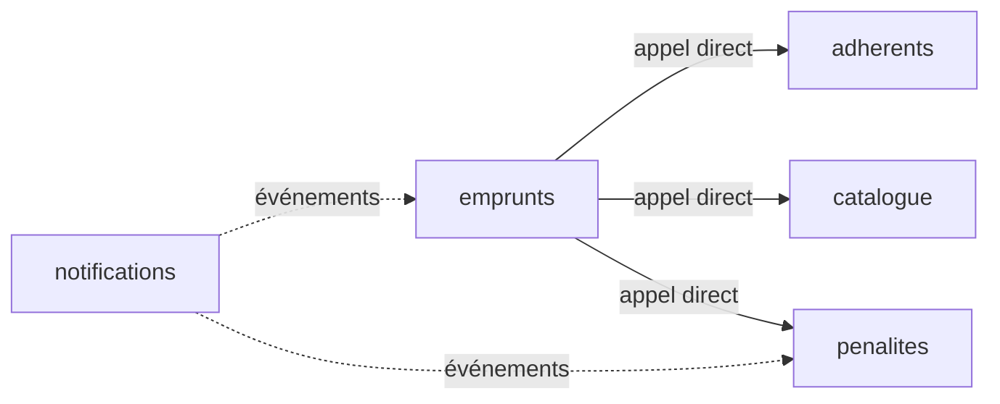

# SunuBiblio — prêts de la bibliothèque universitaire

Monolithe modulaire Spring Boot + Spring Modulith (TP Module 5.2, projet 2).
Base de données : PostgreSQL `SunuBiblio` (tests : H2 en mémoire).

Binôme : Mansour Niang et Abdoulaye Ly. Dépôt : `abdoulayely-7/SunuBiblio`, branche `feat/sunubiblio`.

Les neuf fonctionnalités F1 à F9 du sujet sont réalisées, plus le module `notifications` (hors liste).

## 1. Conception

### 1.1 Les modules

| Module | Responsabilité | Il possède | Il expose (porte d'entrée) | Il annonce | Dépend de |
|---|---|---|---|---|---|
| `catalogue` | Connaître les livres et savoir si chaque exemplaire est disponible, emprunté ou retiré. | Livre, Exemplaire (états `DISPONIBLE`, `EMPRUNTE`, `RETIRE`) | `CatalogueApi`, `LivreDto`, `ExemplaireDto` | — | — |
| `adherents` | Inscrire les adhérents et dire combien d'exemplaires chacun peut emprunter. | Adhérent (type étudiant ou enseignant, quota) | `AdherentsApi`, `AdherentDto`, `TypeAdherent` | — | — |
| `penalites` | Calculer, enregistrer et encaisser les pénalités de retard. | Pénalité (jours de retard, montant, statut) | `PenalitesApi`, `PenaliteDto` | `PenaliteCreee`, `PenalitePayee` | — |
| `emprunts` | Prêter et reprendre les exemplaires en appliquant les règles de prêt (quota, 14 jours, blocage). | Emprunt (dates de prêt, d'échéance et de retour) | `EmpruntsApi`, `EmpruntDto`, `RetourDto`, `SituationAdherentDto` | `EmpruntEnregistre`, `ExemplaireRendu` | `adherents`, `catalogue`, `penalites` |
| `notifications` | Prévenir l'adhérent (SMS simulé dans les logs). | Journal des messages (en mémoire) | `NotificationsApi`, `NotificationDto` | — | `emprunts`, `penalites` |

Chaque module est un package sous `lydevtech.sunubiblio`. La porte d'entrée (interface, DTO, événements, exceptions publiques) est à la racine du module ; tout le reste est dans `internal` (`domain`, `application`, `infrastructure`).

`notifications` n'est pas dans la liste F1 à F9 du sujet : c'est un ajout volontaire (prévenir l'adhérent), qui sert aussi de module écouteur d'événements.

### 1.2 Chaque fonctionnalité dans un seul module

| N° | Fonctionnalité | Module |
|---|---|---|
| F1 | Ajouter un livre et ses exemplaires | `catalogue` |
| F2 | Retirer un exemplaire abîmé | `catalogue` |
| F3 | S'inscrire comme adhérent (étudiant ou enseignant) | `adherents` |
| F4 | Rechercher un livre et voir les exemplaires disponibles | `catalogue` |
| F5 | Emprunter un exemplaire | `emprunts` |
| F6 | Rendre un exemplaire | `emprunts` |
| F7 | Créer une pénalité quand un exemplaire est rendu en retard | `penalites` |
| F8 | Payer sa pénalité | `penalites` |
| F9 | Consulter ses emprunts en cours et ses pénalités | `emprunts` (il lit déjà `penalites`) |

### 1.3 Règles du métier : où elles vivent

| Règle | Module | Où dans le code |
|---|---|---|
| Un étudiant emprunte au plus 3 exemplaires, un enseignant 5 | `adherents` (le quota) et `emprunts` (le comptage) | `TypeAdherent`, `RegleEmprunt` |
| Un prêt dure 14 jours | `emprunts` | `Emprunt` |
| La pénalité est de 100 XOF par jour de retard | `penalites` | `Penalite` |
| Un adhérent avec une pénalité impayée ne peut pas emprunter | `emprunts` (décision) grâce à `penalites` (information) | `RegleEmprunt` |

### 1.4 Schéma des dépendances (sans cycle)



Trait plein : appel direct par l'API publique. Trait pointillé : écoute d'un événement (elle crée aussi une dépendance, vers le module qui définit l'événement).

| Flèche | Type | Pourquoi |
|---|---|---|
| `emprunts` → `adherents` | appel direct | Il faut connaître le type et le quota de l'adhérent tout de suite pour accepter ou refuser l'emprunt. |
| `emprunts` → `catalogue` | appel direct | Il faut vérifier et marquer l'exemplaire « emprunté » dans la même transaction que l'emprunt ; au retour, il est rendu disponible de la même façon. |
| `emprunts` → `penalites` | appel direct | Réponse immédiate nécessaire (« y a-t-il une pénalité impayée ? »), et la pénalité est créée dans la même transaction que le retour en retard. |
| `notifications` → `emprunts` | événements `EmpruntEnregistre`, `ExemplaireRendu` | Prévenir l'adhérent est un effet de bord : il ne doit ni bloquer ni annuler un emprunt, et `emprunts` n'a pas à connaître `notifications`. |
| `notifications` → `penalites` | événements `PenaliteCreee`, `PenalitePayee` | Même raison. |

### 1.5 Pourquoi il n'y a pas de cycle

Le piège du sujet est la paire `emprunts` / `penalites` : un emprunt doit demander s'il y a une pénalité impayée (`emprunts` → `penalites`), et une pénalité naît d'un retour (on pourrait vouloir `penalites` → `emprunts` en écoutant `ExemplaireRendu`). Ensemble, cela ferait un cycle. J'ai choisi un seul sens : `emprunts` → `penalites`. C'est donc `emprunts` qui appelle `penalites` au retour en retard, et `penalites` ne connaît personne. `notifications` est une feuille : elle écoute, mais personne ne dépend d'elle.

### 1.6 Les deux modes de communication

- Appels directs : `emprunts` appelle `AdherentsApi`, `CatalogueApi` et `PenalitesApi`.
- Événements : `emprunts` publie `EmpruntEnregistre` et `ExemplaireRendu`, `penalites` publie `PenaliteCreee` et `PenalitePayee` ; `notifications` les écoute.
- Références par identifiant : seuls des `UUID` (identifiants d'adhérent, d'exemplaire, d'emprunt, de pénalité) et des DTO traversent les frontières, jamais un objet du domaine.

## 2. Structure du code

```text
lydevtech.sunubiblio
├── SunuBiblioApplication, DotenvEnvironmentPostProcessor      (racine, hors module)
└── catalogue | adherents | penalites | emprunts | notifications
    ├── <Module>Api, DTO, événements, exceptions publiques     (porte d'entrée, racine du module)
    ├── package-info.java                                      (allowedDependencies)
    └── internal
        ├── domain          règles du métier (sans Spring) et ports (interfaces de dépôt)
        ├── application     services (cas d'usage) et écouteurs d'événements
        └── infrastructure  persistence (JDBC), web (contrôleurs), configuration
```

Chaque module possède ses tables (`catalogue_*`, `adherents_*`, `emprunts_*`, `penalites_*`) dans son propre script `src/main/resources/db/schema-<module>.sql`. Il n'y a aucune clé étrangère ni jointure entre modules.

## 3. Lancer le projet

Prérequis : JDK 17 ou plus, PostgreSQL avec une base nommée `SunuBiblio`.

```bash
cp .env.example .env        # puis renseigner DB_URL, DB_USERNAME et DB_PASSWORD
./mvnw spring-boot:run
```

Le fichier `.env` n'est jamais commité. Les tables sont créées au démarrage.

### L'API REST

| Fonctionnalité | Requête |
|---|---|
| F1 Ajouter un livre et ses exemplaires | `POST /livres` `{"titre", "auteur", "nombreExemplaires"}` ; `POST /livres/{id}/exemplaires` |
| F2 Retirer un exemplaire abîmé | `DELETE /exemplaires/{id}` |
| F3 S'inscrire | `POST /adherents` `{"nom", "type": "ETUDIANT" ou "ENSEIGNANT"}` |
| F4 Rechercher un livre | `GET /livres?q=texte` ; `GET /livres/{id}` |
| F5 Emprunter | `POST /emprunts` `{"adherentId", "exemplaireId"}` |
| F6 Rendre | `POST /emprunts/{id}/retour` (corps optionnel `{"dateRetour": "AAAA-MM-JJ"}`, par défaut aujourd'hui) |
| F7 Pénalité de retard | automatique au retour en retard |
| F8 Payer une pénalité | `POST /penalites/{id}/paiement` |
| F9 Emprunts en cours et pénalités | `GET /situations/{adherentId}` |
| Messages envoyés (SMS simulé) | `GET /notifications?adherentId=...` |

Les erreurs suivent le format Problem Details (`application/problem+json`) : 400 requête invalide, 404 ressource inconnue, 409 règle du métier refusée.

### Rejouer le scénario à la main

```bash
curl -X POST localhost:8080/livres -H "Content-Type: application/json" \
  -d '{"titre":"Une si longue lettre","auteur":"Mariama Ba","nombreExemplaires":1}'
curl -X POST localhost:8080/adherents -H "Content-Type: application/json" \
  -d '{"nom":"Awa Diop","type":"ETUDIANT"}'
curl -X POST localhost:8080/emprunts -H "Content-Type: application/json" \
  -d '{"adherentId":"<id adhérent>","exemplaireId":"<id exemplaire>"}'
curl localhost:8080/livres/<id livre>                     # 0 exemplaire disponible
curl -X POST localhost:8080/emprunts/<id emprunt>/retour -H "Content-Type: application/json" \
  -d '{"dateRetour":"<dateEcheance + 3 jours>"}'          # pénalité de 300 XOF
curl -X POST localhost:8080/emprunts -H "Content-Type: application/json" \
  -d '{"adherentId":"<id adhérent>","exemplaireId":"<id exemplaire>"}'   # 409 : refusé
curl -X POST localhost:8080/penalites/<id pénalité>/paiement
curl -X POST localhost:8080/emprunts -H "Content-Type: application/json" \
  -d '{"adherentId":"<id adhérent>","exemplaireId":"<id exemplaire>"}'   # 201 : accepté
```

## 4. Tests

```bash
./mvnw test                      # toute la suite : 60 tests
./mvnw test -Dtest=ModulesTest   # seulement le gardien des frontières
```

Résultat observé : `Tests run: 60, Failures: 0, Errors: 0, Skipped: 0`.

| Test | Rôle |
|---|---|
| `ModulesTest` (2) | Le gardien : `verify()` doit passer, et les 5 modules attendus sont bien détectés (le test ne passe donc pas à vide). |
| `ScenarioBoutEnBoutTest` (1) | Le scénario du sujet, étape par étape par l'API REST, avec chaque résultat annoncé vérifié (exemplaire indisponible, retard de 3 jours, pénalité de 300 XOF, nouvel emprunt refusé, paiement, emprunt accepté, messages envoyés). |
| Tests de domaine (26) | Les règles du métier sans Spring ni base : états d'un exemplaire, quotas, 14 jours, 100 XOF par jour, blocage. |
| Tests d'intégration (29) | Chaque module par l'API REST : catalogue, adhérents, pénalités (événements publiés), règles d'emprunt, notifications (aucun message pour une transaction annulée). |
| `BaseDeTestTest` | Garde : les tests tournent sur H2 en mémoire, jamais sur la base PostgreSQL `SunuBiblio`. |

## 5. Étape 3 : casser une frontière

### 5.1 Accès à une classe `internal` d'un autre module

J'ai ajouté dans `emprunts` une classe qui utilise `lydevtech.sunubiblio.catalogue.internal.domain.Exemplaire`. L'application compile (`./mvnw compile` réussit), mais `./mvnw test -Dtest=ModulesTest` échoue :

```text
org.springframework.modulith.core.Violations:
- Module 'emprunts' depends on non-exposed type lydevtech.sunubiblio.catalogue.internal.domain.Exemplaire within module 'catalogue'!
Exemplaire declares return type Exemplaire.exemplaireInterneDuCatalogue() in (ViolationVolontaire.java:0)
- Module 'emprunts' depends on non-exposed type lydevtech.sunubiblio.catalogue.internal.domain.Exemplaire within module 'catalogue'!
Method <lydevtech.sunubiblio.emprunts.internal.application.ViolationVolontaire.exemplaireInterneDuCatalogue()> has return type <lydevtech.sunubiblio.catalogue.internal.domain.Exemplaire> in (ViolationVolontaire.java:0)
```

Correction : j'ai supprimé la classe fautive. La bonne façon de faire est de passer par la porte d'entrée du module : `emprunts` appelle `CatalogueApi` (par exemple `marquerEmprunte(exemplaireId)`) et ne manipule que des identifiants et des DTO. Le domaine d'un module reste privé.

### 5.2 Cycle entre modules

J'ai ensuite fait écouter à `penalites` l'événement `ExemplaireRendu` d'`emprunts`, alors qu'`emprunts` appelle déjà `penalites`. L'application compile encore, mais `ModulesTest` échoue (message raccourci, `[...]` marque les lignes omitées) :

```text
org.springframework.modulith.core.Violations:
- Cycle detected: Slice emprunts ->
                Slice penalites ->
                Slice emprunts
  1. Dependencies of Slice emprunts
    - Method <...EmpruntsService.emprunter(...)> calls method <...PenalitesApi.aPenaliteImpayee(java.util.UUID)> in (EmpruntsService.java:53)
    [...]
  2. Dependencies of Slice penalites
    - Method <...EcouteurCirculaire.surRetour(lydevtech.sunubiblio.emprunts.ExemplaireRendu)> has parameter of type <lydevtech.sunubiblio.emprunts.ExemplaireRendu> in (EcouteurCirculaire.java:0)
- Module 'penalites' depends on module 'emprunts' via lydevtech.sunubiblio.penalites.internal.application.EcouteurCirculaire -> lydevtech.sunubiblio.emprunts.ExemplaireRendu. Allowed targets: none.
```

Correction : j'ai supprimé l'écouteur. Écouter un événement crée une dépendance vers le module qui le définit : il faut choisir un seul sens (`emprunts` appelle `penalites`), et `penalites` n'a pas besoin de connaître `emprunts`.

Dans les deux cas la suite complète est repassée au vert (60 tests).

## 6. Décisions d'architecture

| Décision | Contexte | Conséquences |
|---|---|---|
| Un seul sens `emprunts` → `penalites` (appel direct) | Un emprunt doit savoir s'il y a une pénalité impayée, et une pénalité naît d'un retour : deux sens feraient un cycle. | `emprunts` appelle `penalites` au retour en retard et pour le blocage ; `penalites` ne connaît personne. Le paiement d'une pénalité ne passe par aucun appel vers `emprunts`. |
| Écouteurs `@TransactionalEventListener` (après commit) | Les messages ne doivent pas bloquer ni survivre à une opération annulée. | Un emprunt annulé ne prévient personne (testé). Les écouteurs sont synchrones : le scénario est déterministe. |
| Notifications en mémoire et dans les logs | Les notifications sont de simples lignes de log d'après le sujet. | Le journal est perdu au redémarrage ; changer cela ne touche que `InMemoryNotificationRepository`. |
| PostgreSQL à l'exécution, H2 en mémoire pour les tests | Base demandée : `SunuBiblio`. Les tests ne doivent jamais modifier les vraies données. | Le profil `test` impose H2 ; `BaseDeTestTest` le vérifie. Le `.env` a la priorité la plus basse et ne peut pas écraser une propriété de test. |
| Chaque règle à un seul endroit | Les valeurs (3 et 5 exemplaires, 14 jours, 100 XOF) ne doivent pas être recopiées. | `TypeAdherent` (quotas), `Emprunt.DUREE_PRET_JOURS`, `Penalite.TARIF_PAR_JOUR_XOF`. |
| Changements d'état par mise à jour conditionnelle (`... WHERE etat = ?`) | Deux emprunts simultanés du même exemplaire. | Un seul gagne ; l'autre reçoit un 409. |

### Hypothèses retenues (règles ambiguës)

1. Un retour le jour de l'échéance, ou avant, n'est pas en retard ; le retard se compte en jours calendaires après l'échéance.
2. Un adhérent avec une pénalité impayée ne peut plus emprunter, mais peut toujours rendre ses exemplaires.
3. Le quota compte les emprunts en cours (non rendus).
4. Un exemplaire en cours d'emprunt ne peut pas être retiré (il doit d'abord être rendu) ; un exemplaire retiré ne peut plus être emprunté.
5. Une pénalité est créée par emprunt rendu en retard et se paie en une seule fois.
6. Le retour accepte une date (par défaut aujourd'hui, jamais avant la date d'emprunt) pour rejouer un retard sans attendre 14 jours.
7. Pas d'authentification (hors périmètre du TP).

### Glossaire

| Terme | Sens | À éviter |
|---|---|---|
| Livre | Une œuvre du catalogue (titre, auteur). | document, ouvrage |
| Exemplaire | Un exemplaire physique d'un livre, `DISPONIBLE`, `EMPRUNTE` ou `RETIRE`. | copie, volume |
| Adhérent | Étudiant ou enseignant inscrit à la bibliothèque. | usager, lecteur, client |
| Emprunt | Le prêt d'un exemplaire à un adhérent, pour 14 jours. | prêt (en dehors de la durée), location |
| Retour | Le moment où l'adhérent rend l'exemplaire. | restitution |
| Pénalité | Somme due pour un retard (100 XOF par jour), `IMPAYEE` ou `PAYEE`. | amende, frais de retard |
