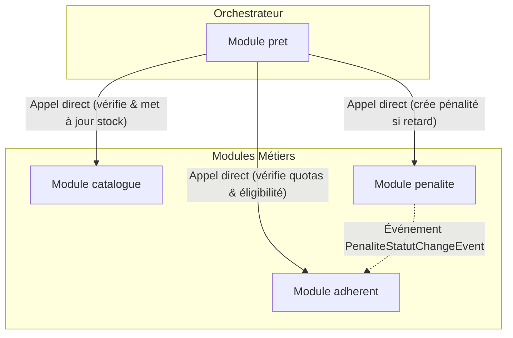

# SunuBiblio — Prêts de la Bibliothèque Universitaire
> Monolithe Modulaire avec Spring Boot & Spring Modulith

---

## 1. Présentation du Projet

**SunuBiblio** est un système de gestion des prêts d'une bibliothèque universitaire (étudiants et enseignants). Il permet de suivre les livres et leurs exemplaires physiques, les emprunts, les retards, ainsi que la facturation et le recouvrement des pénalités.

### Règles Métier
* **Quotas d'emprunt** : Un étudiant peut emprunter au plus **3 exemplaires** à la fois ; un enseignant au plus **5 exemplaires**.
* **Durée de prêt** : **14 jours**.
* **Pénalité de retard** : **100 XOF par jour de retard**.
* **Règle de blocage** : Un adhérent ayant une pénalité impayée **ne peut plus emprunter**.

### Scénario de bout en bout
1. Ajouter un livre avec 1 exemplaire.
2. Inscrire un étudiant.
3. Emprunter l'exemplaire.
4. Vérifier que l'exemplaire n'est plus disponible.
5. Rendre l'exemplaire avec 3 jours de retard.
6. Constater qu'une pénalité de 300 XOF existe et que l'exemplaire est de nouveau disponible.
7. Tenter un nouvel emprunt ➔ **refusé** car l'adhérent a une pénalité impayée.
8. Payer la pénalité.
9. Tenter à nouveau l'emprunt ➔ **accepté**.

---

## 2. Découpage en Modules & Répartition des Fonctionnalités

Le système est découpé en **4 modules métiers** étanches :

| Module | Responsabilité | Fonctionnalités couvertes |
| :--- | :--- | :--- |
| **`catalogue`** | Gestion du catalogue de livres, du stock d'exemplaires physiques et de leur disponibilité. | **F1** (Ajout livre/exemplaires), **F2** (Retrait exemplaire abîmé), **F4** (Recherche livre & dispo) |
| **`adherent`** | Gestion des comptes adhérents (étudiant/enseignant), de leurs quotas et de leur statut d'éligibilité (bloqué/actif). | **F3** (Inscription adhérent) |
| **`pret`** | Orchestration du cycle de vie des emprunts et retours, vérification des conditions de prêt et calcul des retards. | **F5** (Emprunter), **F6** (Rendre), **F9** (Consultation emprunts) |
| **`penalite`** | Source de vérité sur la création des pénalités financières et leur encaissement/paiement. | **F7** (Création pénalité), **F8** (Paiement pénalité), **F9** (Consultation pénalités) |

---

## 3. Spécification des Modules (Tableau de Conception)

| Module | Responsabilité | Il possède (Interne) | Il expose (API Publique) | Il annonce (Événements) | Dépend de |
| :--- | :--- | :--- | :--- | :--- | :--- |
| **`catalogue`** | Gestion des livres et du stock d'exemplaires physiques | `Livre`, `Exemplaire`, `StatutExemplaire` (DISPONIBLE, EMPRUNTE, RETIRE) | `CatalogueApi` (ajouterLivre, verifierDisponibilite, marquerEmprunte, marquerDisponible) | *(aucun)* | *(aucun)* |
| **`penalite`** | Gestion comptable des pénalités et encaissements | `Penalite`, `StatutPenalite` (IMPAYEE, REGLEE) | `PenaliteApi` (creerPenalite, reglerPenalite, getPenalitesAdherent) | `PenaliteStatutChangeEvent` (adherentId, aDesImpayes) | *(aucun)* |
| **`adherent`** | Gestion des profils adhérents et de leur éligibilité | `Adherent`, `TypeAdherent` (ETUDIANT, ENSEIGNANT) | `AdherentApi` (inscrire, verifierEligibiliteEmprunt) | *(aucun)* | **`penalite`** *(écoute l'événement `PenaliteStatutChangeEvent`)* |
| **`pret`** | Orchestration des prêts et calcul des retards | `Emprunt`, `StatutEmprunt` (EN_COURS, RESTITUE) | `PretApi` (emprunter, restituer, getEmpruntsEnCours) | *(aucun)* | **`catalogue`**, **`adherent`**, **`penalite`** *(appels directs synchrones)* |

---

## 4. Schéma des Dépendances & Justification des Flux

### Schéma Architectural (Graphe Acyclique)



### Justification des modes de communication et absence de cycle :
1. **Appels directs de `pret` vers `catalogue`, `adherent` et `penalite` :**
   * Pour valider un emprunt, `pret` doit garantir de façon atomique et synchrone que :
     * L'adhérent existe, respecte son quota et n'est pas bloqué (`adherent`).
     * L'exemplaire existe et est physiquement disponible (`catalogue`).
   * Lors d'une restitution en retard, `pret` demande directement à `penalite` de créer la dette financière correspondante.
2. **Événement `PenaliteStatutChangeEvent` de `penalite` vers `adherent` :**
   * `penalite` est la source de vérité financière. Dès qu'une pénalité est créée (impayée) ou réglée (solde à zéro), `penalite` publie cet événement.
   * `adherent` écoute cet événement et met à jour son drapeau interne `estBloquePourImpayes`.
   * **Conséquence :** `adherent` dépend de `penalite`. `penalite` ne connaît absolument pas `adherent` ni `pret`.
3. **Absence totale de cycle :**
   * `catalogue` : 0 dépendance.
   * `penalite` : 0 dépendance.
   * `adherent` : dépend uniquement de `penalite`.
   * `pret` : dépend de `catalogue`, `adherent`, `penalite`.
   * Aucune flèche de retour ➔ **DAG (Directed Acyclic Graph) parfait**.

---

## 5. Commandes d'Exécution et Tests

```bash
# Lancer tous les tests (vérification des frontières Spring Modulith + scénario de bout en bout)
./mvnw test

# Lancer uniquement le test d'architecture Spring Modulith
./mvnw test -Dtest=ModulesTest
```

---

## 6. Étape 3 : Démonstration de Violation de Frontière (ArchUnit / Modulith)
*(Sera complété lors de l'étape 3 avec le message d'erreur exact généré par Spring Modulith)*
